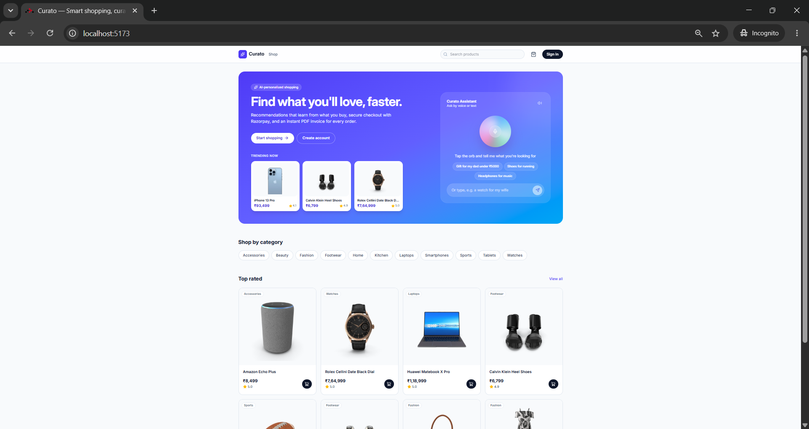
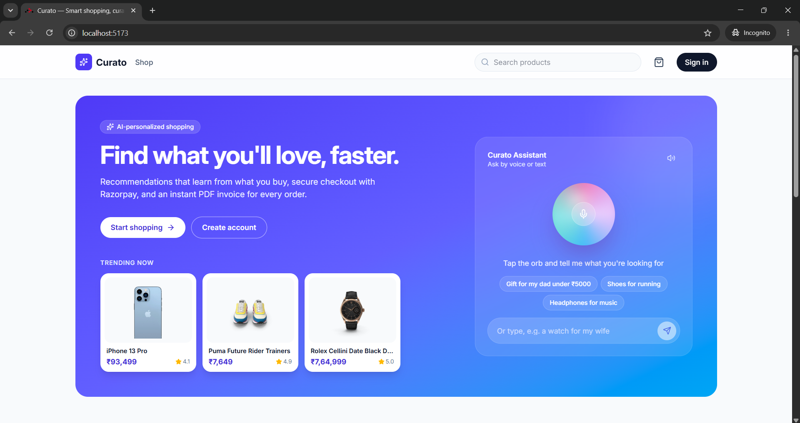
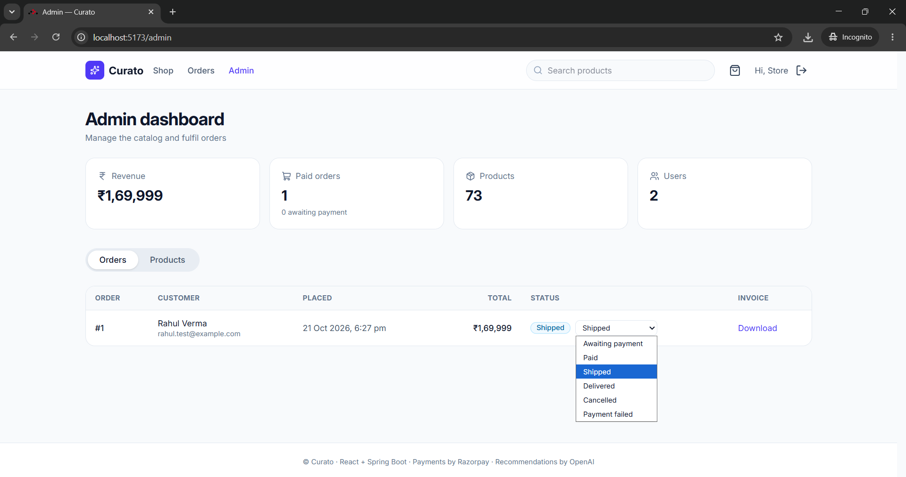
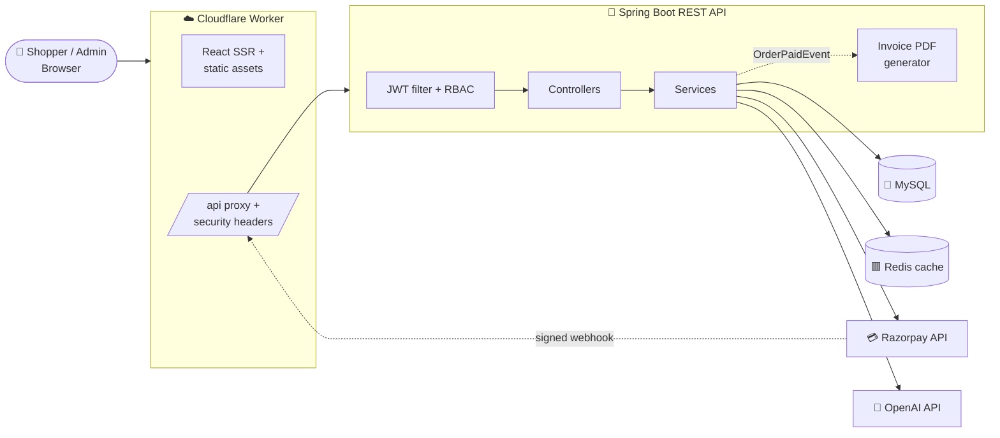
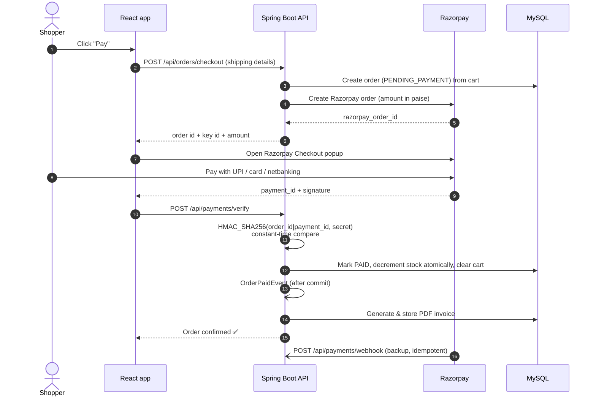
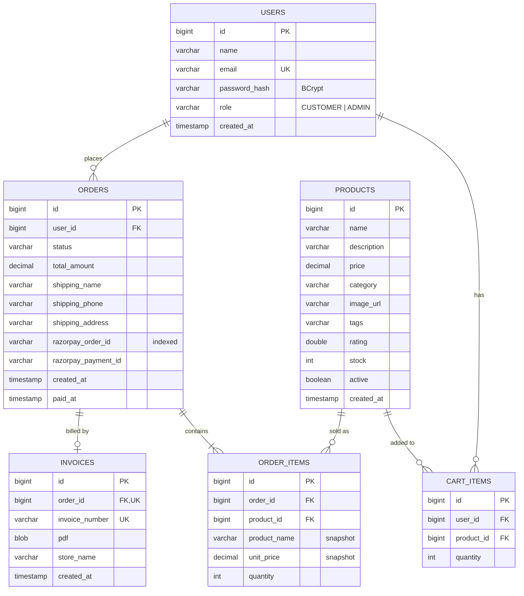

<div align="center">

# 🛍️ Curato — AI-Powered E-Commerce Platform

**A full-stack online store with secure Razorpay payments, automatic PDF invoices, OpenAI-powered product
recommendations and a voice shopping assistant.**


</div>

## 📸 Demo

<table>
  <tr>
    <td align="center" width="33%">
      <a href="public/Images/Home_page.png"></a>
      <br><b>Home page</b><br>
      <sub>Hero with trending products, categories and top-rated items</sub>
    </td>
    <td align="center" width="33%">
      <a href="public/Images/Ai_assistant.png"></a>
      <br><b>AI voice assistant</b><br>
      <sub>Speak or type a request and get matching products</sub>
    </td>
    <td align="center" width="33%">
      <a href="public/Images/Admin_dashboard.png"></a>
      <br><b>Admin dashboard</b><br>
      <sub>Revenue stats, order fulfilment and invoice downloads</sub>
    </td>
  </tr>
</table>

<sub>Click any screenshot to view it full size.</sub>

---

## 📑 Table of contents

- [Overview](#-overview)
- [Features](#-features)
- [Tech stack](#-tech-stack)
- [System architecture](#-system-architecture)
- [Payment flow](#-payment-flow)
- [Database schema](#-database-schema)
- [Folder structure](#-folder-structure)
- [Getting started](#-getting-started)
- [Configuration](#-configuration)
- [API reference](#-api-reference)
- [Security](#-security)
- [Testing](#-testing)
- [Deployment](#-deployment)
- [Engineering highlights](#-engineering-highlights)
- [Future improvements](#-future-improvements)

---

## 🔎 Overview

Curato is a production-style e-commerce web application built with a **React** frontend and a **Spring Boot REST
API**. Shoppers can browse a 73-product catalog, add items to a cart, and pay with **Razorpay** (UPI, cards,
netbanking). After every successful payment a **GST-style PDF invoice** is generated automatically.

What makes it "AI-powered":

- 🤖 **Personalized recommendations.** The **OpenAI API** turns each shopper's orders and cart into a profile and picks
  the products they're most likely to buy next, with a short reason for each.
- 🎙️ **Voice shopping assistant.** A Siri-style orb on the home page. Shoppers say *"a gift for my dad under 5000"*,
  and the assistant answers out loud and shows matching products.

The API is secured with **JWT authentication** and **role-based access control** (customer / admin). The catalog and
recommendations are cached in **Redis**, and the frontend runs at the edge on **Cloudflare Workers**.

---

## ✨ Features

### 🛒 Shopper features

| Feature | Details |
|---|---|
| **Product catalog** | 73 products in 11 categories, with search, category filters, sorting (newest, price low–high, price high–low, top rated) and pagination |
| **Product pages** | Images, description, rating, stock status and a "You might also like" section of similar products |
| **Shopping cart** | Add, update quantity and remove items. Saved on the server, so it follows the user across devices |
| **Secure checkout** | Shipping details form, then a Razorpay payment popup (UPI, cards, netbanking, wallets) |
| **Order history** | List of past orders with live status badges (Paid, Shipped, Delivered, …) |
| **PDF invoices** | A downloadable tax invoice for every paid order, with invoice number, line items, GST breakdown and totals |
| **AI recommendations** | A "Recommended for you" section on the home page, ranked by OpenAI from purchase history and cart |
| **Voice assistant** | Speak or type a request. It understands product types, who a gift is for, and budgets ("under 20k", "under 1 lakh") |
| **Accounts** | Register, log in and log out with JWT. Sessions persist across reloads |

### 🛠️ Admin features

| Feature | Details |
|---|---|
| **Dashboard stats** | Total revenue, paid orders, orders awaiting payment, product count and user count |
| **Order management** | View every order with customer details and update its status (Paid → Shipped → Delivered, or Cancelled) |
| **Invoice access** | Download any customer's invoice |
| **Product management** | Create, edit, deactivate and delete products, and manage stock levels |

### ⚙️ Platform features

| Feature | Details |
|---|---|
| **Razorpay integration** | Server-side order creation, HMAC-SHA256 signature verification and a signed webhook |
| **Automatic invoicing** | Generated by an event listener once the payment transaction commits |
| **Redis caching** | Products, catalog pages, categories, recommendations and similar items, each with its own expiry time and cleared when data changes |
| **Graceful degradation** | If Redis is down the app reads from MySQL. If OpenAI is unavailable a built-in recommender takes over |
| **Edge proxy** | The Cloudflare Worker serves the React app, proxies `/api/*` to the backend and adds security headers |
| **Mock payment mode** | Payments can be simulated, so the whole flow is demoable without a Razorpay account |

---

## 🧰 Tech stack

| Layer | Technologies |
|---|---|
| **Frontend** | React 19, React Router 8 (framework mode, SSR), TypeScript, Tailwind CSS 4, Vite 8, lucide-react, Web Speech API |
| **Edge** | Cloudflare Workers (`@cloudflare/vite-plugin`, Wrangler) |
| **Backend** | Java 21, Spring Boot 4.1, Spring Web MVC, Spring Security 7, Spring Data JPA (Hibernate 7), Bean Validation |
| **Auth** | JWT (jjwt 0.13), BCrypt password hashing, method-level `@PreAuthorize` |
| **Database** | MySQL 8 (production), H2 (zero-setup development profile) |
| **Caching** | Redis 7 via Spring Cache |
| **Payments** | Razorpay Java SDK, HMAC-SHA256 verification, webhooks |
| **AI** | OpenAI Chat Completions API (`gpt-4o-mini` by default) with JSON-mode responses |
| **PDF** | OpenPDF |
| **Testing** | JUnit 5, Spring Boot Test, MockMvc, Spring Security Test |
| **DevOps** | Maven Wrapper, Docker Compose (MySQL + Redis), Bun / npm |

---

## 🏗️ System architecture



**Request path:** the browser only talks to the Cloudflare Worker. The Worker server-renders the React app and forwards
every `/api/*` request to Spring Boot. The browser and API share one origin, so no CORS preflight is needed and the
backend address stays hidden.

---

## 💳 Payment flow



Both the verify endpoint and the webhook are **idempotent**. If the shopper closes the tab after paying, the webhook
still confirms the order, and a payment that arrives twice is never processed twice.

---

## 🗄️ Database schema



**Design notes**

- **Snapshots in `order_items`.** The product name and price are copied at purchase time, so later price changes
  never alter past orders or invoices.
- **One cart row per product.** A `(user_id, product_id)` unique constraint means re-adding a product increases its
  quantity instead of adding a duplicate row.
- **Order status lifecycle:** `PENDING_PAYMENT → PAID → SHIPPED → DELIVERED`, with `PAYMENT_FAILED` and `CANCELLED`
  as exits.
- **Prices** are `DECIMAL(12,2)` and handled as `BigDecimal`. Floating point is never used for money.
- **Invoice store name.** Each invoice records the store name it was printed with. If the store is renamed, older
  invoices are re-rendered automatically and keep the same invoice number.

---

## 📁 Folder structure

```
ai-powered-ecommerce-platform/
├── app/                              # ⚛️ React frontend (React Router 8, framework mode)
│   ├── components/
│   │   ├── AuthCard.tsx              # Shared login/register card + safe redirect helper
│   │   ├── Navbar.tsx                # Brand, search, cart badge, user menu
│   │   ├── ProductCard.tsx           # Product tile, image, rating, add-to-cart hook
│   │   ├── Toast.tsx                 # Toast notifications
│   │   ├── VoiceAssistant.tsx        # 🎙️ Siri-style voice/text shopping assistant
│   │   └── ui.tsx                    # RequireAuth guard, spinner, shared UI
│   ├── context/
│   │   ├── auth.tsx                  # JWT session state
│   │   └── cart.tsx                  # Server-backed cart state
│   ├── lib/
│   │   ├── api.ts                    # Fetch wrapper (JWT header, errors, file download)
│   │   ├── format.ts                 # INR currency, dates, order status labels
│   │   └── types.ts                  # TypeScript types matching the API DTOs
│   ├── routes/
│   │   ├── home.tsx                  # Hero, trending, AI recommendations, categories
│   │   ├── products.tsx              # Catalog with search / filter / sort / pagination
│   │   ├── product.tsx               # Product detail + similar products
│   │   ├── cart.tsx                  # Cart
│   │   ├── checkout.tsx              # Shipping form + Razorpay checkout
│   │   ├── orders.tsx                # Order history
│   │   ├── order.tsx                 # Order detail + invoice download
│   │   ├── login.tsx / register.tsx  # Authentication pages
│   │   └── admin.tsx                 # Admin dashboard (stats, orders, products)
│   ├── app.css                       # Tailwind theme + assistant orb animations
│   ├── root.tsx                      # App shell, providers, navbar, footer
│   └── routes.ts                     # Route table
│
├── workers/
│   └── app.ts                        # ☁️ Cloudflare Worker: SSR, /api proxy, security headers
│
├── public/
│   └── Images/                       # README screenshots
│
├── backend/                          # 🍃 Spring Boot REST API
│   ├── src/main/java/com/aishop/
│   │   ├── BackendApplication.java
│   │   ├── config/
│   │   │   ├── AppProperties.java    # Typed config (JWT, Razorpay, OpenAI, store details)
│   │   │   ├── SecurityConfig.java   # Stateless JWT security, URL rules, CORS
│   │   │   ├── CacheConfig.java      # Redis caches, per-cache expiry, fault-tolerant error handler
│   │   │   └── DataSeeder.java       # Seeds admin account + 73 products
│   │   ├── security/
│   │   │   ├── JwtService.java       # Issue / validate tokens
│   │   │   ├── JwtAuthFilter.java    # Bearer token → SecurityContext
│   │   │   └── AuthUser.java         # Authenticated principal
│   │   ├── controller/               # Auth, Product, Cart, Order, Payment,
│   │   │                             # Recommendation, Assistant, Admin
│   │   ├── service/
│   │   │   ├── AuthService.java
│   │   │   ├── ProductService.java   # Cached catalog queries
│   │   │   ├── CartService.java
│   │   │   ├── OrderService.java     # Checkout, status changes, dashboard stats
│   │   │   ├── PaymentService.java   # Razorpay orders, signature checks, webhook
│   │   │   ├── InvoiceService.java   # PDF tax invoice generation
│   │   │   ├── RecommendationService.java  # OpenAI + content-based fallback
│   │   │   ├── AssistantService.java # Voice assistant: intent, budget, matching
│   │   │   ├── OpenAiClient.java     # Chat Completions client (JSON mode)
│   │   │   └── OrderPaidEvent.java   # Domain event published after payment
│   │   ├── entity/                   # User, Product, CartItem, Order, OrderItem, Invoice, enums
│   │   ├── repository/               # Spring Data JPA repositories
│   │   ├── dto/                      # Request / response records
│   │   └── exception/                # ApiException + RFC 7807 ProblemDetail handler
│   ├── src/main/resources/
│   │   ├── application.yml           # Profiles: default (MySQL+Redis), local, dev
│   │   └── seed/products.json        # Catalog seed data
│   ├── src/test/java/com/aishop/     # Integration + unit tests
│   ├── docker-compose.yml            # MySQL 8.4 + Redis 7.4
│   ├── .env.example                  # Configuration template
│   └── pom.xml
│
├── package.json
├── vite.config.ts
├── wrangler.jsonc                    # Worker config (API_BASE_URL)
└── README.md
```

---

## 🚀 Getting started

### Prerequisites

- **Java 21+**
- **Node.js 22.22+** or **Bun**
- *Optional:* MySQL 8 and Redis 7 (or Docker). Without them, the `dev` profile runs everything in memory.

### 1. Clone and configure

```bash
git clone https://github.com/Sagan2k4/ai-powered-ecommerce-platform.git
cd ai-powered-ecommerce-platform/backend
cp .env.example .env        # then fill in the values you need (see Configuration)
```

### 2. Start the backend. Pick one profile:

| Profile | Command | Database | Cache | Best for |
|---|---|---|---|---|
| `dev` | `./mvnw spring-boot:run -Dspring-boot.run.profiles=dev` | Embedded H2 file | In-memory | Quick start, no installs |
| `local` | `./mvnw spring-boot:run -Dspring-boot.run.profiles=local` | **MySQL** | In-memory | MySQL installed, no Redis |
| *(default)* | `./mvnw spring-boot:run` | **MySQL** | **Redis** | Full production-like stack |

> On Windows use `.\mvnw.cmd` and quote the flag: `.\mvnw.cmd spring-boot:run "-Dspring-boot.run.profiles=local"`

For the full stack with Docker:

```bash
docker compose up -d        # starts MySQL 8.4 + Redis 7.4
./mvnw spring-boot:run
```

The API starts on **http://localhost:8080**. On first run it creates the database, an admin account and 73 products.

### 3. Start the frontend

```bash
cd ..                       # project root
bun install                 # or: npm install
bun run dev                 # or: npm run dev  →  http://localhost:5173
```

### 4. Log in

| Role | Email | Password |
|---|---|---|
| Admin | `admin@aishop.dev` | `Admin@12345` (override with `ADMIN_EMAIL` / `ADMIN_PASSWORD`) |
| Customer | Register through the UI | — |

> 💡 With `RAZORPAY_MOCK=true` (the default), checkout simulates a successful payment, so the whole flow works without
> any keys.

---

## 🔧 Configuration

All settings live in `backend/.env` (git-ignored) or environment variables. Environment variables take precedence.

| Variable | Purpose | Default |
|---|---|---|
| `DB_URL`, `DB_USERNAME`, `DB_PASSWORD` | MySQL connection | `localhost:3306/aishop`, `root`, empty |
| `REDIS_HOST`, `REDIS_PORT`, `REDIS_PASSWORD` | Redis connection | `localhost`, `6379` |
| `JWT_SECRET` | Base64 HMAC key (≥ 256 bits). **Always set in deployed environments** | dev key |
| `JWT_EXPIRATION` | Token lifetime | `24h` |
| `RAZORPAY_KEY_ID`, `RAZORPAY_KEY_SECRET` | Razorpay API keys (`rzp_test_…` for test mode) | empty |
| `RAZORPAY_WEBHOOK_SECRET` | Secret configured on the Razorpay webhook | empty |
| `RAZORPAY_MOCK` | `true` simulates payments; `false` uses real Razorpay | `true` |
| `OPENAI_API_KEY` | Enables AI recommendations and the AI assistant | empty (built-in fallback) |
| `OPENAI_MODEL` | Chat model | `gpt-4o-mini` |
| `ADMIN_EMAIL`, `ADMIN_PASSWORD` | Seeded admin account | `admin@aishop.dev`, `Admin@12345` |
| `CORS_ORIGINS` | Allowed browser origins (only needed when calling the API directly) | `http://localhost:5173` |

**Real Razorpay test payments:** create a free Razorpay account, generate **test mode** keys, set
`RAZORPAY_MOCK=false` with your `rzp_test_…` keys, and pay with Razorpay's published test cards or UPI ID
`success@razorpay`.

---

## 📡 API reference

All endpoints are under `/api`. Errors are returned as RFC 7807 `application/problem+json`.

| Method | Endpoint | Description | Access |
|---|---|---|---|
| `POST` | `/auth/register` | Create a customer account, returns JWT | Public |
| `POST` | `/auth/login` | Log in, returns JWT | Public |
| `GET` | `/auth/me` | Current user | Signed in |
| `GET` | `/products?q=&category=&sort=&page=&size=` | Search and browse the catalog | Public |
| `GET` | `/products/{id}` | Product details | Public |
| `GET` | `/products/{id}/similar` | Related products | Public |
| `GET` | `/products/categories` | All categories | Public |
| `POST` | `/assistant` | Voice/text assistant `{ "message": "a watch for my wife under 20k" }` | Public |
| `GET` | `/cart` | View cart | Customer |
| `POST` | `/cart/items` | Add item `{ productId, quantity }` | Customer |
| `PATCH` | `/cart/items/{id}` | Change quantity | Customer |
| `DELETE` | `/cart/items/{id}` | Remove item | Customer |
| `POST` | `/orders/checkout` | Create order + Razorpay order | Customer |
| `GET` | `/orders` | My orders | Customer |
| `GET` | `/orders/{id}` | Order details | Owner or admin |
| `GET` | `/orders/{id}/invoice` | Download PDF invoice | Owner or admin |
| `POST` | `/payments/verify` | Verify Razorpay signature, confirm order | Customer |
| `POST` | `/payments/failed` | Record a failed/cancelled payment | Customer |
| `POST` | `/payments/webhook` | Razorpay server-to-server event | Razorpay (signed) |
| `GET` | `/recommendations` | Personalized AI recommendations | Customer |
| `GET` | `/admin/stats` | Dashboard metrics | Admin |
| `GET` `PATCH` | `/admin/orders`, `/admin/orders/{id}/status` | List orders, update status | Admin |
| `POST` `PUT` `DELETE` | `/admin/products`, `/admin/products/{id}` | Create, update, delete products | Admin |

<details>
<summary><b>Example: AI assistant request</b></summary>

```http
POST /api/assistant
Content-Type: application/json

{ "message": "phone under 30k" }
```

```json
{
  "reply": "Here are my top picks in smartphones and accessories within your budget.",
  "items": [
    { "product": { "id": 41, "name": "iPhone 6", "price": 25499.00, "category": "Smartphones", "...": "..." },
      "reason": "Matches what you asked for" }
  ],
  "source": "fallback"
}
```

`source` is `openai` when the model answered and `fallback` when the built-in matcher did.
</details>

---

## 🔐 Security

- **Stateless JWT authentication.** Tokens are signed with HMAC-SHA256 and the server stores no sessions.
- **RBAC at two layers.** URL rules (`/api/admin/** → ADMIN`) plus class-level `@PreAuthorize("hasRole('ADMIN')")` on the admin controller.
- **Ownership checks.** Customers can only read their own orders and invoices; anyone else gets a 404.
- **BCrypt** password hashing. Passwords are never logged or returned.
- **Payment integrity.**
  - Razorpay signatures are verified with a **constant-time comparison**, so attackers can't use timing to guess them.
  - Webhooks are verified against the raw request body.
  - Amounts are always computed on the server and never trusted from the client.
- **AI output validation.** Every product id returned by OpenAI is checked against the live catalog, so the model can
  never recommend a product that doesn't exist or is out of stock.
- **Input validation** with Bean Validation on every request DTO, and consistent error responses.
- **Edge security headers** added by the Cloudflare Worker (`Strict-Transport-Security`, `X-Content-Type-Options`,
  `X-Frame-Options`, `Referrer-Policy`, `Permissions-Policy`).
- **Secrets** come only from environment variables or the git-ignored `.env` file. None are committed.

---

## 🧪 Testing

```bash
cd backend
./mvnw test
```

The test suite runs against an in-memory database with simulated payments and covers:

- ✅ Public catalog access
- ✅ 401 for anonymous users and 403 for customers on admin endpoints
- ✅ The full **checkout → forged signature rejected → payment verified → invoice PDF generated → cart cleared**
  flow
- ✅ Order isolation between customers
- ✅ Personalized recommendations
- ✅ Assistant matching by category and budget, plus input validation
- ✅ Razorpay HMAC signature verification

---

## ☁️ Deployment

| Component | How |
|---|---|
| **Backend** | `./mvnw package` → run `target/*.jar` on any JVM host (Render, Railway, AWS EC2, …) with the environment variables above, pointing at managed MySQL and Redis |
| **Frontend** | Set `API_BASE_URL` in `wrangler.jsonc` to the backend URL, then `bun run deploy` (Cloudflare Workers) |
| **Razorpay webhook** | Point it at `https://<your-domain>/api/payments/webhook` with the `payment.captured` event and set `RAZORPAY_WEBHOOK_SECRET` |

---

## 💡 Engineering highlights

- **Event-driven invoicing.** Invoices are generated by a `@TransactionalEventListener` that runs only after the payment
  transaction commits, so an invoice is never produced for a rolled-back payment.
- **Race-safe stock.** Stock is decremented with a single conditional `UPDATE … WHERE stock >= :qty`, so two shoppers
  can never buy the last unit at the same time.
- **Hybrid recommender.**
  - A content-based scorer (category complements, shared tags, price band, rating, diversity cap) first shortlists
    candidates. This keeps the OpenAI prompt small and cheap.
  - OpenAI then ranks the shortlist and explains each pick.
  - The same scorer is the fallback when no API key is set.
- **Natural-language assistant.**
  - Understands everyday words (*phone*, *sneakers*, *perfume*) and who a gift is for (*dad*, *wife*).
  - Understands Indian budget phrasing (*under 20k*, *under 1 lakh*).
  - Uses the browser's Web Speech API for voice input and spoken replies.
- **Resilient caching.** A custom `CacheErrorHandler` means a Redis outage slows the app down instead of breaking it.
  Cached recommendations are cleared as soon as the user buys something.
- **Three runtime profiles** (H2 / MySQL / MySQL + Redis) let the same code run anywhere from a laptop with nothing
  installed to production.
- **Polished UX.**
  - Loading placeholders, toast notifications, and no layout shift while filtering.
  - SSR for fast first paint.
  - Accessible controls (ARIA labels, live regions, reduced-motion support).

---

## 🔭 Future improvements

- Product reviews and ratings from verified buyers
- Wishlist and email notifications on order status changes (Spring Mail / Kafka)
- Coupon codes and discounts
- Product image upload to Cloudflare R2
- Full-text search with Elasticsearch / OpenSearch
- CI/CD with GitHub Actions and containerized backend deployment

---

<div align="center">

**Built with ☕ Java, 🍃 Spring Boot and ⚛️ React**

If you found this project interesting, please consider giving it a ⭐

</div>
